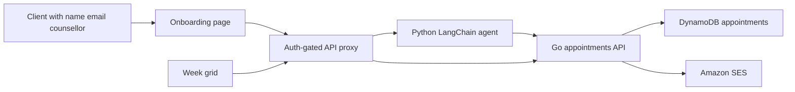

# Counsellor booking assistant

After a client has a name, an email, and a selected counsellor, a Python LangChain agent helps them pick a time and books it. 

The client sees that next booking on the page and gets an Amazon SES confirmation email. 

They can also ask the agent to request a new time. 

Appointments are stored in the Go backend's DynamoDB. 

Only an admin can view & edit the week grid.

## Diagram

DynamoDB is the source of truth. The onboarding page keeps the chat transcript and sends it on every turn, so the agent does not need Postgres or any other LangChain state database.

## Functional Requirements

- The booking chat appears only after the saved client has a first name, an email, and a `requested_counsellor`. Until then it stays hidden.

- The agent already knows the client and the counsellor. It asks only for a time, offers real free slots, and books only after the client picks one.

- Slots are 60 minutes on the hour, inside the working hours already listed for the seven sample practitioners.

- A booking that overlaps another booked appointment, or falls outside those hours, is rejected.

- The client sees their next booking on the onboarding page: counsellor, date, and start and end time. If they have none, the page says so.

- A confirmed booking sends one Amazon SES email to the client. The message names the client, the counsellor, and the time. Confirmed means a new appointment, an admin move, or an accepted change request.

- The booking is saved before the email is sent. If SES fails, the appointment stays and the page says the email was not sent.

- Filing a change request, declining one, or cancelling does not send that confirmation.

- A client who already has a booking can ask the agent for a new time. That files a pending change request and does not move the appointment. The current time stays until an admin accepts it.

- The agent cannot cancel a booking.

- Only a user with JWT role `admin` can move a booking, cancel one, or accept or decline a change request. Other logged-in users can open the week grid and read it.

- After each create, move, cancel, or accepted change, the client's `next_appointment` is their earliest remaining future booking.

- Google Calendar is out of scope.

- The Python LangChain service lives in its own repo, `python-langchain-booking`, beside the Go API. This Next.js app only stores `BOOKING_AGENT_URL`.

# Non Functional Requirements

- Assumption that fast api can adequitely handle concurrency as users and request frequency increase this is to be validated as we build
- Having a seperately deployable sevice increases scalability options perhaps service with be deployed to different regions. 
- Investigate enforcing Db constraints as algorithm checks may be vulnerable to race conditions       
- Caching and redis locking may also be implemented to aid performance and reliability.
- Impode
- Rate limiting to prevent abuse.
- JWT token to be used to ensure users in authenticated to be called by the nodejs app  
- Idempotency keys to be used to prevent duplicate operations send by the cleint to the back end python service
- Add Langsmith logging or add another logging section to my application where we can compare the relative perfomance to the go back and service and the python service 
- Also add token usages information and errors/defects.   

## Steps

### 1. Python LangChain booking agent

Create the FastAPI service in [PYTHON_SERVICE_BOOKING], on port 8003.

To be verified 
- `agent.py` uses LangChain `ChatOpenAI` and `create_react_agent`.
- Tools, closed over the selected client and counsellor: `list_free_slots`, `book_appointment`, `request_change`.
- `POST /chat` returns 400 if name, email, or counsellor is missing.
- `calendar.py` calls the Go API and forwards the bearer token. It does not store bookings.
- Pytest covers slot generation and the three tools against a mocked Go client. OpenAI is not called.

### 2. DynamoDB tables

Add the tables in `john_ai_project` `cmd/create-db/main.go`, the same way the `clients` table is created.

- `appointments`: hash key `id`, GSI `counsellor-start-index` on `counsellor_id` and `start`. Attributes include `client_id`, `client_name`, `client_email`, `end`, `status` (`booked` or `cancelled`), `created_at`, `updated_at`.
- `appointment_change_requests`: hash key `id`, GSI `counsellor-status-index` on `counsellor_id` and `status`. Attributes include `appointment_id`, `client_email`, `current_start`, `requested_start`, `status` (`pending`, `accepted`, or `declined`), `created_at`, `updated_at`.

### 3. Go backend routes

Add repository, service, handler, and routes in `john_ai_project`, using the existing JWT middleware. The repository reads and writes the tables from step 2.

- `GET /api/appointments?counsellor_id=&from=&to=`
- `POST /api/appointments`
- `PUT /api/appointments/{id}`
- `DELETE /api/appointments/{id}`
- `POST /api/appointments/{id}/change-requests`
- `POST /api/appointment-change-requests/{id}/accept`
- `POST /api/appointment-change-requests/{id}/decline`

Any logged-in user can list, create, and file a change request for their own appointment. Move, cancel, accept, and decline require role `admin` and return 403 otherwise. One pending change request per appointment; a new request replaces a pending one.

Send the confirmation with Amazon SES (`sesv2` on the AWS SDK already used for DynamoDB). `SES_FROM_EMAIL` is the verified sender. Tests use a fake sender and do not contact SES.

### 4. Frontend

In this Next.js app:

- Show `BookingAssistant` on the onboarding page once name, email, and counsellor are saved. Suggested times are buttons that send that slot as the next message.
- Show the next booking on the client profile above the chat.
- Add `/bookings`, a week grid. Admins can move, cancel, accept, and decline. Everyone else sees a read-only diary.
- `app/api/booking/*` checks the login cookie, proxies chat to `BOOKING_AGENT_URL`, and proxies grid reads and writes to the Go routes. If `BOOKING_AGENT_URL` is unset, the chat routes return 503.
